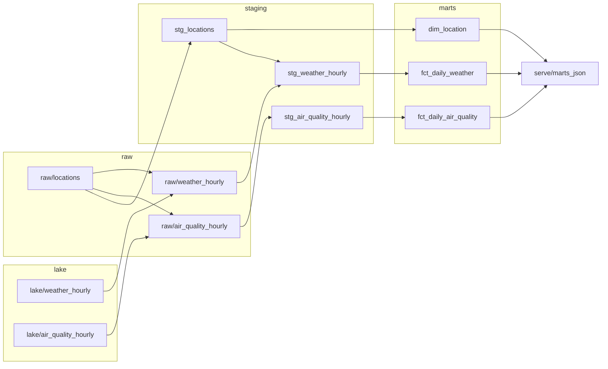

# Antilles Data Pipeline

[](https://github.com/tomtessondev/antilles-data-pipeline/actions/workflows/ci.yml)
[](https://tomtessondev.github.io/antilles-data-pipeline/)

A production-style data pipeline built on open data from **Guadeloupe and Martinique**.
It extracts hourly weather and air quality (including Saharan dust) from the
[Open-Meteo](https://open-meteo.com/) APIs, loads them into **DuckDB**, transforms it with **dbt**, and runs on a schedule with **GitHub Actions**.

The goal is to show, end to end, how I structure a data project meant to run in production:
typed and tested Python, idempotent loads, retries, data-quality tests, CI/CD and containers.

## Architecture

```
Open-Meteo weather ─────┐                         lake: S3, Parquet
                        ├─► extract (httpx + retries) ──► partitioned by ──► DuckDB raw.* ──► dbt staging ──► dbt marts
Open-Meteo air quality ─┘                                  extraction date     (latest wins)      (tests)         │
                                                                                                                 ▼
                                          Next.js dashboard ◄── marts.json on the `data` branch ◄── export (daily)
```

| Layer | Tooling | Where |
| --- | --- | --- |
| Extract | Python 3.11+, httpx, tenacity (exponential retries) | `src/antilles_pipeline/extract.py` |
| Land | Every extraction appended as Parquet to S3 (or a local directory), Hive-partitioned by extraction date, written by DuckDB | `src/antilles_pipeline/lake.py` |
| Load | DuckDB rebuilds the raw tables from the whole lake, latest extraction per `(location, hour)` | `src/antilles_pipeline/lake.py`, `load.py` |
| Transform | dbt-duckdb: staging views, incremental daily facts, location dimension, tests, source freshness | `transform/` |
| Orchestration | Dagster assets (dbt models as assets, dbt tests as asset checks), retries, daily schedule; run by Docker Compose locally and by a GitHub Actions cron in production | `src/antilles_pipeline/orchestration/`, `docker-compose.yml`, `.github/workflows/pipeline.yml` |
| Quality | pytest + respx (HTTP mocked), ruff, mypy `--strict` | `tests/`, `.github/workflows/ci.yml` |
| Documentation | dbt docs (lineage, column descriptions, tests) on GitHub Pages | `.github/workflows/docs.yml` |
| Serve | `antilles-pipeline export` to JSON; Next.js, TypeScript, Recharts, zod-validated contract | `src/antilles_pipeline/export.py`, `dashboard/` |
| Packaging | pyproject, CLI entry point, multi-stage Docker image (CLI and Dagster targets) | `pyproject.toml`, `Dockerfile` |
| Infrastructure | Terraform on AWS (`us-east-2`): S3 lake, remote state with native locking, least-privilege CI identity, budget alert | `infra/` |

### Orchestration

The pipeline is defined once, as Dagster assets. The raw assets use the keys dbt gives its
sources, so the graph connects from the APIs to the dashboard file without glue code:



- **One job, two runners.** `daily_pipeline` runs at 06:00 Antilles time under the Dagster
  daemon (`make up`), and the GitHub Actions cron executes the same job with
  `dagster job execute`, then publishes the JSON for the dashboard.
- **Retries at two levels**: tenacity retries each HTTP call; a Dagster retry policy
  re-runs a whole extraction asset (3 times, exponential backoff from 5 minutes).
- **dbt tests are asset checks**: a failing test shows on the asset in the UI and fails
  the run before the export, so the dashboard never receives untested data.
- **One writer**: every step writes the same DuckDB file, so the job uses the in-process
  executor and the Docker instance allows one run at a time.

## Quick start

```bash
python -m venv .venv && source .venv/bin/activate
make install                              # pip install -e ".[dev,orchestration]"

antilles-pipeline run --past-days 7      # extract + load into data/antilles.duckdb
make transform                            # dbt build (models + tests)
make check                                # lint, type-check, tests
make docs                                 # dbt docs as a single static HTML page
make dagster                              # Dagster UI with hot reload (dagster dev)
```

Orchestration with Docker Compose: Dagster webserver and daemon, the lake in a local
S3-compatible store (SeaweedFS, bucket `antilles-lake`), DuckDB and the export in `./data`:

```bash
make up                                   # http://localhost:3070, daily schedule on
make down
```

Without Compose, the lake is `data/lake` on disk. Point `ANTILLES_LAKE_URL` at
`s3://<bucket>[/prefix]` to use S3, with the usual `AWS_*` credentials
(`ANTILLES_S3_ENDPOINT` only for S3-compatible stores).

Dashboard (reads the bundled sample unless `MARTS_URL` is set):

```bash
cd dashboard && npm ci && npm run dev    # http://localhost:3000
```

CLI only, with Docker:

```bash
docker build -t antilles-pipeline .
docker run --rm -v "$PWD/data:/data" antilles-pipeline run --past-days 7
```

## Data model

Browse the models, lineage graph and column descriptions in the
[dbt docs](https://tomtessondev.github.io/antilles-data-pipeline/), rebuilt from fixture data
on every merge to `main`.

- `raw.locations`: the six towns tracked (3 in Guadeloupe, 3 in Martinique).
- `raw.weather_hourly`, `raw.air_quality_hourly`: one row per location and hour, primary key
  `(location_code, observed_at)`.
- `stg_locations`, `stg_weather_hourly`, `stg_air_quality_hourly`: typed and renamed.
- `dim_location`: one row per town with territory and coordinates.
- `fct_daily_weather`: daily min/max/avg temperature, total rainfall, max wind, per town.
- `fct_daily_air_quality`: daily PM10 and PM2.5, peak Saharan dust, ozone, European AQI, and
  a flag when the daily PM10 mean exceeds the EU limit (50 µg/m³).
- Both facts are **incremental**: each run rebuilds only the (town, day) pairs that received
  new hourly rows, from all of that day's hours. CI loads the data twice to exercise this path.
- **Source freshness** on `extracted_at` for both raw tables: warns after 26 h, fails after
  50 h (`make freshness`).

Air quality comes from the CAMS global model (coarse grid, interpolated by Open-Meteo), not
from ground stations: it shows regional episodes such as Saharan dust well, but differences
between two neighbouring towns are smoothing, not local measurements.

## Design choices

- **An append-only lake as the source of truth.** Each run re-sends the last 31 days, so
  the same hour arrives in several extractions. The lake keeps all of them, untouched,
  partitioned by extraction date; loading picks the latest per `(location, hour)`. The
  DuckDB file is disposable: any run rebuilds the raw tables, with the full history, from
  the lake. Partitioning by extraction date rather than observation date keeps writes
  append-only (a run never rewrites an existing file) at the cost of reading every file on
  load, which stays small here (a few MB a year).
- **DuckDB does the I/O**: it writes the Parquet partitions and reads them back over S3
  (httpfs), so there is no pandas or pyarrow step. Tests run the S3 path against a moto
  server, Docker Compose against SeaweedFS (MinIO no longer publishes images).
- **Least-privilege CI access to AWS.** The daily run can list the lake, read and add
  files, nothing else (no delete, no other bucket). The intended setup is an IAM role
  assumed through GitHub OIDC from `main` only, with no stored keys. The AWS free plan
  denies creating OIDC providers, so this account uses a dedicated IAM user with the same
  policy and a key kept in GitHub secrets; switching back is one Terraform variable
  (`ci_auth`). Details in [infra/README.md](infra/README.md).
- **Idempotent loads**: re-running a day never duplicates rows (`insert or replace` on the key).
- **Past hours only**: the forecast endpoint also returns the rest of today as predictions;
  hours after the extraction time are dropped. `observed_at` is local Antilles time (UTC−4),
  `extracted_at` is UTC.
- **Retries with backoff** on network errors and 5xx answers; a malformed payload fails loudly.
- **Config by environment variables** (`ANTILLES_DB_PATH`, `ANTILLES_LAKE_URL`,
  `ANTILLES_WEATHER_API`, `ANTILLES_AIR_QUALITY_API`), no secrets in code.
- **Tests never hit the network**: the APIs are mocked with respx and JSON fixtures.
- **Dashboard without a database server**: the daily run exports the marts to one JSON
  file on the `data` branch (a single commit, replaced each run). The dashboard fetches it
  and refreshes hourly, so publishing new data needs no redeploy and no secret. The JSON
  is parsed with zod; CI exports the fixture build and runs the dashboard's schema test
  against it, so a column renamed in dbt fails the pull request.
- **Why not fuel prices?** The national fuel price feed has no station in Guadeloupe or
  Martinique: prices there are capped monthly by prefectoral order, published only as PDF.

## Roadmap

Full plan in [docs/ROADMAP.md](docs/ROADMAP.md).

- [x] Python package: extract, load, CLI, tests, CI
- [x] dbt staging and daily mart with data-quality tests
- [x] Incremental facts, location dimension, source freshness
- [x] Second source: air quality and Saharan dust (Open-Meteo, CAMS)
- [x] dbt docs published on GitHub Pages
- [x] Next.js dashboard reading the marts
- [x] Orchestration with Dagster, run locally with Docker Compose
- [x] Raw data as partitioned Parquet on S3, queried from DuckDB
- [x] Infrastructure as code with Terraform (S3 lake, IAM, remote state, budget)

## Author

Tom Tesson, data engineer and FPGA engineer, based in Guadeloupe (UTC−4), available for remote missions.
